# Database Schema: cinema_management_dev

Tài liệu cấu trúc cơ sở dữ liệu MongoDB cho hệ thống quản lý rạp chiếu phim (`cinema_management_dev`).

Dữ liệu được tổ chức thành các collection chứa document BSON. Dữ liệu liên quan được mô hình hóa bằng **embedded document** (nhúng) hoặc **tham chiếu ObjectId**, tùy theo kích thước dữ liệu, cách truy xuất và vòng đời của đối tượng. MongoDB không có ràng buộc khóa ngoại như cơ sở dữ liệu quan hệ: các tham chiếu `ObjectId` được kiểm tra hợp lệ ở tầng ứng dụng (Express / Mongoose) trước khi tạo hoặc cập nhật.

> **Nguồn:** Cấu trúc trường được tổng hợp từ tài liệu *Collection description* (thiết kế) và các document mẫu có trong database. Trường chỉ thấy trong dữ liệu thực tế mà tài liệu thiết kế chưa liệt kê được ghi chú *(có trong DB, chưa có trong tài liệu thiết kế)*.

---

## 1. Tổng quan các Collections

| STT | Collection | Trạng thái schema | Mô tả chức năng |
| :--- | :--- | :--- | :--- |
| 1 | `accounts` | Có dữ liệu | Tài khoản người dùng, nhân viên, quản trị viên |
| 2 | `roles` | Có dữ liệu | Vai trò / Phân quyền nhóm người dùng |
| 3 | `permissions` | Có dữ liệu | Danh mục quyền hạn chi tiết trong hệ thống |
| 4 | `movies` | Có dữ liệu | Thông tin phim chiếu rạp |
| 5 | `branches` | Có dữ liệu | Chi nhánh rạp chiếu phim |
| 6 | `rooms` | Có dữ liệu | Phòng chiếu thuộc từng chi nhánh (kèm sơ đồ ghế nhúng) |
| 7 | `showtimes` | Đã thiết kế | Suất chiếu phim theo phòng và khung giờ |
| 8 | `showtime_seats` | Đã thiết kế | Trạng thái ghế ngồi theo từng suất chiếu |
| 9 | `bookings` | Đã thiết kế | Đơn đặt vé của khách |
| 10 | `tickets` | Đã thiết kế | Chi tiết từng vé xem phim |
| 11 | `payments` | Đã thiết kế | Giao dịch thanh toán (vé hoặc đơn bắp nước) |
| 12 | `refund_requests` | Đã thiết kế | Yêu cầu hủy vé / hoàn tiền |
| 13 | `promotions` | Đã thiết kế | Chương trình khuyến mãi |
| 14 | `vouchers` | Đã thiết kế | Mã giảm giá thuộc chương trình khuyến mãi |
| 15 | `movie_reviews` | Đã thiết kế | Đánh giá, nhận xét phim từ khách hàng |
| 16 | `staff_shifts` | Đã thiết kế | Ca làm việc của nhân viên rạp |
| 17 | `orders` | Đã thiết kế | Đơn hàng bắp nước (online hoặc tại quầy) |
| 18 | `concession_categories` | Đã thiết kế | Danh mục sản phẩm bắp nước |
| 19 | `concessions` | Đã thiết kế | Sản phẩm đồ ăn, thức uống |
| 20 | `combos` | Đã thiết kế | Gói combo bắp nước |
| 21 | `inventories` | Đã thiết kế | Tồn kho bắp nước theo chi nhánh |
| 22 | `suppliers` | Đã thiết kế | Nhà cung cấp hàng hóa |
| 23 | `stock_transactions` | Đã thiết kế | Lịch sử nhập / xuất / điều chỉnh kho |
| 24 | `email_verifications` | *Chưa có thiết kế* | Mã hoặc token xác thực email |
| 25 | `audit_logs` | Đã thiết kế | Nhật ký thao tác quản trị (append-only), thêm mới cho ROLE-101..103 / STAFF-101 |

**Chú thích trạng thái:**
* *Có dữ liệu*: đã có document mẫu trong database.
* *Đã thiết kế*: đã có cấu trúc trong tài liệu thiết kế, chưa có document mẫu.
* *Chưa có thiết kế*: chưa có trong tài liệu thiết kế lẫn database.

---

## 2. Chi tiết cấu trúc các Collections

### Nhóm A — Tài khoản & Phân quyền

### 2.1. `accounts`
Lưu trữ thông tin xác thực, hồ sơ người dùng, vai trò, quyền gán trực tiếp và thông tin nhân viên (nếu tài khoản thuộc nhân viên nội bộ).

| Trường (Field) | Kiểu dữ liệu | Quan hệ / Ghi chú |
| :--- | :--- | :--- |
| `_id` | `ObjectId` | Khóa chính (Primary Key) |
| `username` | `string` | Tên đăng nhập. **Unique**, bắt buộc |
| `email` | `string` | Địa chỉ email. **Unique**, bắt buộc |
| `passwordHash` | `string` | Mật khẩu đã mã hóa (chỉ lưu dạng hash) |
| `phone` | `string` | Số điện thoại liên hệ |
| `roleIds` | `Array<ObjectId>` | Tham chiếu đến `roles._id` |
| `directPermissionIds` | `Array<ObjectId>` | Tham chiếu đến `permissions._id` (quyền gán trực tiếp) |
| `status` | `string` | Trạng thái tài khoản (ví dụ: `ACTIVE`, `DISABLED`) |
| `profile` | `Object` (embedded) | Thông tin hồ sơ chung |
| `profile.fullName` | `string` | Họ và tên đầy đủ |
| `profile.dateOfBirth` | `Date` | Ngày sinh |
| `profile.address` | `string` | Địa chỉ |
| `employeeProfile` | `Object` (embedded) | Thông tin nhân viên. **Chỉ có ở tài khoản nhân viên** |
| `employeeProfile.branchId` | `ObjectId` | Tham chiếu đến `branches._id` (chi nhánh làm việc) |
| `employeeProfile.position` | `string` | Chức vụ / vị trí công việc |
| `createdBy` | `ObjectId` *(tùy chọn)* | Tham chiếu `accounts._id` (Admin tạo tài khoản nhân viên) *(thêm mới cho STAFF-101)* |
| `updatedBy` | `ObjectId` *(tùy chọn)* | Tham chiếu `accounts._id` (Admin thay đổi gần nhất) *(thêm mới cho STAFF-101)* |
| `createdAt` | `Date` | Thời điểm tạo |
| `updatedAt` | `Date` | Thời điểm cập nhật gần nhất |
| `__v` | `number` | Version key của Mongoose *(có trong DB, chưa có trong tài liệu thiết kế)* |

---

### 2.2. `roles`
Định nghĩa các vai trò trong hệ thống (RBAC).

| Trường (Field) | Kiểu dữ liệu | Quan hệ / Ghi chú |
| :--- | :--- | :--- |
| `_id` | `ObjectId` | Khóa chính (Primary Key) |
| `name` | `string` | Tên vai trò, **unique** (ví dụ: `ADMIN`, `STAFF`, `CUSTOMER`) |
| `description` | `string` | Mô tả vai trò và trách nhiệm |
| `permissionIds` | `Array<ObjectId>` | Tham chiếu danh sách `permissions._id` (mọi quyền phải tồn tại) |
| `createdBy` / `updatedBy` | `ObjectId` *(tùy chọn)* | Tham chiếu `accounts._id` (Admin tạo / sửa role) *(thêm mới cho ROLE-101..103)* |
| `createdAt` / `updatedAt` | `Date` *(tùy chọn)* | Mongoose timestamps; role seed cũ không có *(thêm mới cho ROLE-101..103)* |

> Tên 4 system role (`ADMIN`, `MANAGER`, `STAFF`, `CUSTOMER`) không bao giờ đổi. `ADMIN` luôn giữ mọi permission và không sửa được qua API. Role không bị xóa (SRS không có use case xóa role).

---

### 2.3. `permissions`
Danh mục các quyền thao tác được định nghĩa sẵn trong hệ thống.

| Trường (Field) | Kiểu dữ liệu | Quan hệ / Ghi chú |
| :--- | :--- | :--- |
| `_id` | `ObjectId` | Khóa chính (Primary Key) |
| `name` | `string` | Mã định danh quyền, **unique** (ví dụ: `MOVIE_CREATE`, `TICKET_CANCEL`) |
| `description` | `string` | Mô tả quyền thao tác |

---

### 2.3a. `audit_logs` *(thêm mới cho ROLE-101..103 / STAFF-101, owner duyệt 2026-10-27)*
Nhật ký bất biến cho thao tác quản trị (CR-20/CR-21). Ứng dụng chỉ insert, không update/xóa. Không lưu secret (password hash, OTP).

| Trường (Field) | Kiểu dữ liệu | Quan hệ / Ghi chú |
| :--- | :--- | :--- |
| `_id` | `ObjectId` | Khóa chính |
| `actorAccountId` | `ObjectId` | Tham chiếu `accounts._id` (người thực hiện), bắt buộc |
| `action` | `string` | `STAFF_ACCOUNT_CREATED`, `STAFF_ACCOUNT_UPDATED`, `STAFF_ACCOUNT_ENABLED`, `STAFF_ACCOUNT_DISABLED`, `STAFF_ACCESS_ASSIGNED`, `ROLE_CREATED`, `ROLE_UPDATED`, `ROLE_PERMISSIONS_ASSIGNED`, `TICKET_CHECKED_IN` (TICKET-101) |
| `targetType` | `string` | `ACCOUNT`, `ROLE` hoặc `TICKET` |
| `targetId` | `ObjectId` | `accounts._id`, `roles._id` hoặc `tickets._id` |
| `summary` | `string` | Mô tả ngắn (≤ 300 ký tự) |
| `changes` | `Object` | Tóm tắt before/after của các field đã đổi, hoặc tên role/permission được thêm/bớt |
| `createdAt` | `Date` | Thời điểm ghi nhận |

Chưa có index phụ: chưa có use case đọc nhật ký (PROJECT_CONVENTIONS §8).

---

### 2.4. `staff_shifts`
Ca làm việc của nhân viên.

| Trường (Field) | Kiểu dữ liệu | Quan hệ / Ghi chú |
| :--- | :--- | :--- |
| `_id` | `ObjectId` | Khóa chính (Primary Key) |
| `employeeAccountId` | `ObjectId` | Tham chiếu đến `accounts._id` (nhân viên được phân ca) |
| `branchId` | `ObjectId` | Tham chiếu đến `branches._id` (chi nhánh diễn ra ca làm) |
| `startTime` | `Date` | Thời điểm bắt đầu ca |
| `endTime` | `Date` | Thời điểm kết thúc ca |
| `station` | `string` | Vị trí làm việc được phân công |
| `status` | `string` | Vòng đời ca đã lưu (**PROPOSED**, CMS_UC38): `SCHEDULED`, `APPROVED`, `CANCELLED`. Document cũ có giá trị khác hoặc thiếu được đọc là `SCHEDULED`. `IN_PROGRESS` / `COMPLETED` **không lưu**: backend tính từ `startTime`/`endTime` và thời điểm hiện tại |
| `createdBy` | `ObjectId` *(tùy chọn)* | Tham chiếu đến `accounts._id` (Manager phân ca) *(thêm mới cho CMS_UC38)* |
| `cancelledBy` | `ObjectId` *(tùy chọn)* | Tham chiếu đến `accounts._id` (Manager hủy ca) *(thêm mới cho CMS_UC38)* |
| `cancelledAt` | `Date` *(tùy chọn)* | Thời điểm hủy ca *(thêm mới cho CMS_UC38)* |
| `approvedBy` | `ObjectId` *(tùy chọn)* | Tham chiếu đến `accounts._id` (**người duyệt**: Manager duyệt ca đã kết thúc) *(thêm mới cho CMS_UC38)* |
| `approvedAt` | `Date` *(tùy chọn)* | Thời điểm duyệt ca *(thêm mới cho CMS_UC38)* |
| `approvalNote` | `string` *(tùy chọn)* | Ghi chú khi duyệt (tối đa 500 ký tự) *(thêm mới cho CMS_UC38)* |
| `createdAt`, `updatedAt` | `Date` | Mongoose tự cập nhật; document cũ có thể thiếu |

> **CMS_UC38 chỉ làm phần ca làm việc tối thiểu: vòng đời ca, vị trí làm việc (`station`, văn bản tự do) và người duyệt (`approvedBy`).** Không có dữ liệu chấm công (clock-in/clock-out, nghỉ giải lao, terminal): nhóm chưa chốt, không tự thêm. Nhân viên của một ca là tài khoản `ACTIVE` có role `STAFF` và làm việc tại chi nhánh của Manager (`accounts.employeeProfile.branchId`, cùng quy tắc với Inventory); chi nhánh của ca luôn là chi nhánh của Manager tạo ca. Ca không bị xóa mà chuyển `CANCELLED`.

---

### Nhóm B — Phim & Rạp

### 2.5. `movies`
Danh mục phim và thông tin phát hành.

| Trường (Field) | Kiểu dữ liệu | Quan hệ / Ghi chú |
| :--- | :--- | :--- |
| `_id` | `ObjectId` | Khóa chính (Primary Key) |
| `title` | `string` | Tên phim |
| `synopsis` | `string` | Tóm tắt nội dung phim |
| `director` | `string` | Tên đạo diễn |
| `cast` | `Array<string>` | Danh sách diễn viên |
| `genres` | `Array<string>` | Danh sách thể loại phim (Hành động, Tình cảm...) |
| `duration` | `number` | Thời lượng phim (phút) |
| `language` | `string` | Ngôn ngữ chính của phim |
| `ageRating` | `string` | Giới hạn độ tuổi (ví dụ: `P`, `C13`, `C16`, `C18`) |
| `posterUrl` | `string` | Đường dẫn ảnh poster |
| `landscapePosterUrl` | `string` | Đường dẫn poster ngang (tuỳ chọn; mặc định rỗng) |
| `trailerUrl` | `string` | Đường dẫn video trailer |
| `status` | `string` | Trạng thái phim (ví dụ: `NOW_SHOWING`, `COMING_SOON`) |
| `releaseDate` | `Date` | Ngày khởi chiếu |
| `createdAt` | `Date` | Thời điểm tạo bản ghi *(có trong DB, chưa có trong tài liệu thiết kế)* |
| `updatedAt` | `Date` | Thời điểm cập nhật bản ghi *(có trong DB, chưa có trong tài liệu thiết kế)* |

---

### 2.6. `movie_reviews`
Điểm đánh giá và nhận xét phim do tài khoản khách hàng gửi.

| Trường (Field) | Kiểu dữ liệu | Quan hệ / Ghi chú |
| :--- | :--- | :--- |
| `_id` | `ObjectId` | Khóa chính (Primary Key) |
| `movieId` | `ObjectId` | Tham chiếu đến `movies._id` |
| `customerAccountId` | `ObjectId` | Tham chiếu đến `accounts._id` (khách hàng viết đánh giá) |
| `rating` | `number` | Điểm đánh giá (phải nằm trong thang điểm cho phép) |
| `content` | `string` | Nội dung nhận xét |
| `createdAt` | `Date` | Thời điểm tạo |
| `updatedAt` | `Date` | Thời điểm cập nhật |

> Mỗi khách hàng chỉ được đánh giá một lần cho mỗi phim (unique `movieId` + `customerAccountId`).

---

### 2.7. `branches`
Cơ sở / Chi nhánh rạp chiếu phim.

| Trường (Field) | Kiểu dữ liệu | Quan hệ / Ghi chú |
| :--- | :--- | :--- |
| `_id` | `ObjectId` | Khóa chính (Primary Key) |
| `branchName` | `string` | Tên chi nhánh rạp |
| `address` | `string` | Địa chỉ cụ thể |
| `email` | `string` | Email liên hệ của chi nhánh |
| `hotline` | `string` | Đường dây nóng |
| `status` | `string` | Trạng thái hoạt động (ví dụ: `ACTIVE`, `MAINTENANCE`) |
| `createdAt` | `Date` | Thời điểm tạo *(có trong DB, chưa có trong tài liệu thiết kế)* |
| `updatedAt` | `Date` | Thời điểm cập nhật *(có trong DB, chưa có trong tài liệu thiết kế)* |

---

### 2.8. `rooms`
Phòng chiếu tại từng chi nhánh. Danh sách ghế được **nhúng trực tiếp** trong phòng vì ghế chỉ thuộc về một phòng và thường được lấy cùng sơ đồ phòng.

| Trường (Field) | Kiểu dữ liệu | Quan hệ / Ghi chú |
| :--- | :--- | :--- |
| `_id` | `ObjectId` | Khóa chính (Primary Key) |
| `branchId` | `ObjectId` | Tham chiếu đến `branches._id` |
| `roomName` | `string` | Tên hoặc số phòng (ví dụ: `Screen 1`, `IMAX Hall`) |
| `roomType` | `string` | Định dạng phòng chiếu (ví dụ: `2D`, `3D`, `IMAX`). Nhãn tự do, lưu chữ hoa (`STANDARD`, `2D`, ...). Chính sách giá vé đã duyệt hiện chỉ áp dụng cho `STANDARD`/`2D` |
| `capacity` | `number` | Sức chứa tối đa (phải khớp với sơ đồ ghế). **Luôn do backend tính từ sơ đồ ghế** (UC41); màn hình quản lý phòng không cho ghi trực tiếp. Phòng mới có `capacity = 0` |
| `layoutVersion` | `number` | Phiên bản sơ đồ bố trí ghế *(có trong DB, chưa có trong tài liệu thiết kế)*. Phòng mới tạo có `0` (chưa có sơ đồ ghế) |
| `status` | `string` | Trạng thái phòng **(PROPOSED, ROOM-001)**: `ACTIVE`, `MAINTENANCE`, `INACTIVE`. `AVAILABLE` là cách ghi cũ của `ACTIVE`: vẫn được đọc như `ACTIVE`, không còn được ghi. Chỉ phòng `ACTIVE` (hoặc `AVAILABLE`) được xếp suất chiếu |
| `seats` | `Array<Object>` (embedded) | Danh sách ghế nhúng, mô tả sơ đồ phòng |
| `seats._id` | `ObjectId` | Định danh ghế, **unique trong phòng**. Được tham chiếu bởi `showtime_seats.seatId`, `bookings.seatIds`, `tickets.seatId` |
| `seats.row` | `string` | Ký hiệu hàng ghế |
| `seats.number` | `number` | Số ghế trong hàng |
| `seats.type` | `string` | Loại ghế (ví dụ: `NORMAL`, `VIP`, `COUPLE`) |
| `seats.status` | `string` | Trạng thái vật lý / cấu hình của ghế |
| `createdAt` | `Date` | Thời điểm tạo *(có trong DB, chưa có trong tài liệu thiết kế)* |
| `updatedAt` | `Date` | Thời điểm cập nhật *(có trong DB, chưa có trong tài liệu thiết kế)* |

---

### Nhóm C — Lịch chiếu & Đặt vé

### 2.9. `showtimes`
Suất chiếu phim đã được lên lịch.

| Trường (Field) | Kiểu dữ liệu | Quan hệ / Ghi chú |
| :--- | :--- | :--- |
| `_id` | `ObjectId` | Khóa chính (Primary Key) |
| `movieId` | `ObjectId` | Tham chiếu đến `movies._id` |
| `roomId` | `ObjectId` | Tham chiếu đến `rooms._id` |
| `startTime` | `Date` | Thời điểm bắt đầu suất chiếu |
| `endTime` | `Date` | Thời điểm kết thúc suất chiếu |
| `status` | `string` | Trạng thái suất chiếu |

> Chi nhánh của suất chiếu được xác định gián tiếp qua `roomId` → `rooms.branchId`.

---

### 2.10. `showtime_seats`
Trạng thái đặt chỗ theo thời gian thực của từng ghế trong mỗi suất chiếu. Tách riêng khỏi sơ đồ ghế nhúng trong `rooms` để hỗ trợ khóa ghế và đặt vé đồng thời.

| Trường (Field) | Kiểu dữ liệu | Quan hệ / Ghi chú |
| :--- | :--- | :--- |
| `_id` | `ObjectId` | Khóa chính (Primary Key) |
| `showtimeId` | `ObjectId` | Tham chiếu đến `showtimes._id` |
| `seatId` | `ObjectId` | Tham chiếu đến `rooms.seats._id` (ghế nhúng) |
| `status` | `string` | Trạng thái ghế (ví dụ: `AVAILABLE`, `LOCKED`, `BOOKED`) |
| `lockedBy` | `ObjectId` | Tham chiếu đến `accounts._id` (tài khoản đang giữ ghế tạm) |
| `lockedUntil` | `Date` | Thời điểm hết hạn giữ ghế tạm |

---

### 2.11. `bookings`
Giao dịch đặt vé do khách hàng tạo.

| Trường (Field) | Kiểu dữ liệu | Quan hệ / Ghi chú |
| :--- | :--- | :--- |
| `_id` | `ObjectId` | Khóa chính (Primary Key) |
| `bookingCode` | `string` | Mã đặt vé công khai, **unique** |
| `customerAccountId` | `ObjectId` | Tham chiếu đến `accounts._id` (khách hàng đặt vé) |
| `showtimeId` | `ObjectId` | Tham chiếu đến `showtimes._id` |
| `seatIds` | `Array<ObjectId>` | Tham chiếu đến `rooms.seats._id` (ghế nhúng) |
| `voucherId` | `ObjectId` | Tham chiếu đến `vouchers._id` (nếu có áp dụng) |
| `bookingTime` | `Date` | Thời điểm đặt vé |
| `subtotal` | `number` | Tổng tiền trước giảm giá (≥ 0) |
| `discountAmount` | `number` | Số tiền được giảm (≥ 0) |
| `totalAmount` | `number` | Số tiền phải thanh toán (≥ 0) |
| `status` | `string` | Trạng thái đơn đặt vé |
| `createdAt` | `Date` | Thời điểm tạo |
| `updatedAt` | `Date` | Thời điểm cập nhật |

---

### 2.12. `tickets`
Từng vé xem phim được sinh ra từ đơn đặt vé đã thanh toán thành công.

| Trường (Field) | Kiểu dữ liệu | Quan hệ / Ghi chú |
| :--- | :--- | :--- |
| `_id` | `ObjectId` | Khóa chính (Primary Key) |
| `ticketCode` | `string` | Mã vé, **unique** |
| `bookingId` | `ObjectId` | Tham chiếu đến `bookings._id` |
| `showtimeId` | `ObjectId` | Tham chiếu đến `showtimes._id` |
| `seatId` | `ObjectId` | Tham chiếu đến `rooms.seats._id` (ghế nhúng) |
| `qrCode` | `string` | Giá trị mã QR dùng để soát vé |
| `status` | `string` | Trạng thái vé (ví dụ: `VALID`, `USED`, `CANCELLED`, `REFUNDED`) |
| `checkedInAt` | `Date` | Thời điểm soát vé thành công |
| `checkedInBy` | `ObjectId` *(tùy chọn)* | Tham chiếu `accounts._id` (Staff/Manager soát vé) *(thêm mới cho TICKET-101)* |

---

### Nhóm D — Thanh toán & Hoàn tiền

### 2.13. `payments`
Giao dịch thanh toán cho đơn đặt vé hoặc đơn bắp nước.

| Trường (Field) | Kiểu dữ liệu | Quan hệ / Ghi chú |
| :--- | :--- | :--- |
| `_id` | `ObjectId` | Khóa chính (Primary Key) |
| `bookingId` | `ObjectId` *(tùy chọn)* | Tham chiếu đến `bookings._id` khi thanh toán vé |
| `orderId` | `ObjectId` *(tùy chọn)* | Tham chiếu đến `orders._id` khi thanh toán đơn bắp nước |
| `gatewayTransactionId` | `string` | Mã giao dịch do cổng thanh toán trả về |
| `method` | `string` | Phương thức thanh toán |
| `amount` | `number` | Số tiền giao dịch |
| `status` | `string` | Trạng thái thanh toán |
| `paidAt` | `Date` | Thời điểm thanh toán thành công |
| `gatewayResponse` | `Object` | Dữ liệu phản hồi (thô hoặc đã chuẩn hóa) từ cổng thanh toán |

> Bắt buộc có ít nhất một trong hai trường `bookingId` hoặc `orderId`.

---

### 2.14. `refund_requests`
Yêu cầu hủy đặt vé và hoàn tiền.

| Trường (Field) | Kiểu dữ liệu | Quan hệ / Ghi chú |
| :--- | :--- | :--- |
| `_id` | `ObjectId` | Khóa chính (Primary Key) |
| `bookingId` | `ObjectId` | Tham chiếu đến `bookings._id` |
| `paymentId` | `ObjectId` | Tham chiếu đến `payments._id` |
| `customerAccountId` | `ObjectId` | Tham chiếu đến `accounts._id` (khách hàng yêu cầu) |
| `refundAmount` | `number` | Số tiền yêu cầu / được duyệt hoàn |
| `reason` | `string` | Lý do khách hàng đưa ra |
| `status` | `string` | Trạng thái yêu cầu |
| `requestedAt` | `Date` | Thời điểm gửi yêu cầu |
| `processedAt` | `Date` | Thời điểm xử lý yêu cầu |
| `processedBy` | `ObjectId` | Tham chiếu đến `accounts._id` (người xử lý) |

---

### Nhóm E — Khuyến mãi

### 2.15. `promotions`
Chương trình khuyến mãi và quy tắc giảm giá.

| Trường (Field) | Kiểu dữ liệu | Quan hệ / Ghi chú |
| :--- | :--- | :--- |
| `_id` | `ObjectId` | Khóa chính (Primary Key) |
| `name` | `string` | Tên chương trình |
| `discountType` | `string` | Loại giảm giá |
| `discountValue` | `number` | Giá trị hoặc phần trăm giảm |
| `startDate` | `Date` | Ngày bắt đầu (≤ `endDate`) |
| `endDate` | `Date` | Ngày kết thúc |
| `status` | `string` | Trạng thái chương trình |

---

### 2.16. `vouchers`
Mã giảm giá được phát hành theo chương trình khuyến mãi.

| Trường (Field) | Kiểu dữ liệu | Quan hệ / Ghi chú |
| :--- | :--- | :--- |
| `_id` | `ObjectId` | Khóa chính (Primary Key) |
| `promotionId` | `ObjectId` | Tham chiếu đến `promotions._id` |
| `code` | `string` | Mã voucher nhập khi thanh toán, **unique** |
| `usageLimit` | `number` | Số lần sử dụng tối đa |
| `usedCount` | `number` | Số lần đã sử dụng (≤ `usageLimit`) |
| `validFrom` | `Date` | Ngày bắt đầu hiệu lực |
| `validTo` | `Date` | Ngày hết hiệu lực |
| `status` | `string` | Trạng thái voucher |

---

### Nhóm F — Bắp nước & Kho

### 2.17. `orders`
Đơn hàng bắp nước tạo online hoặc tại quầy. Danh sách món được **nhúng** vì chỉ thuộc về một đơn và thường được lấy cùng đơn.

| Trường (Field) | Kiểu dữ liệu | Quan hệ / Ghi chú |
| :--- | :--- | :--- |
| `_id` | `ObjectId` | Khóa chính (Primary Key) |
| `orderCode` | `string` | Mã đơn công khai, **unique** |
| `customerAccountId` | `ObjectId` | Tham chiếu đến `accounts._id` |
| `branchId` | `ObjectId` | Tham chiếu đến `branches._id` (chi nhánh xử lý đơn) |
| `type` | `string` | Loại đơn (ví dụ: `ONLINE`, `COUNTER`) |
| `items` | `Array<Object>` (embedded) | Danh sách món / combo trong đơn |
| `items.itemType` | `string` | `CONCESSION` hoặc `COMBO` |
| `items.itemId` | `ObjectId` | Tham chiếu `concessions._id` hoặc `combos._id` tùy theo `itemType` |
| `items.name` | `string` | Tên món tại thời điểm mua (snapshot) |
| `items.unitPrice` | `number` | Đơn giá tại thời điểm mua (snapshot) |
| `items.quantity` | `number` | Số lượng (> 0) |
| `items.subtotal` | `number` | Thành tiền của dòng |
| `totalAmount` | `number` | Tổng tiền phải thanh toán |
| `paymentStatus` | `string` | Trạng thái thanh toán của đơn |
| `pickupStatus` | `string` | Trạng thái nhận hàng tại quầy |
| `status` | `string` | Trạng thái tổng của đơn |
| `createdAt` | `Date` | Thời điểm tạo |

---

### 2.18. `concession_categories`
Danh mục phân loại sản phẩm bắp nước.

| Trường (Field) | Kiểu dữ liệu | Quan hệ / Ghi chú |
| :--- | :--- | :--- |
| `_id` | `ObjectId` | Khóa chính (Primary Key) |
| `name` | `string` | Tên danh mục |
| `description` | `string` | Mô tả danh mục |

---

### 2.19. `concessions`
Sản phẩm đồ ăn, thức uống bán tại rạp.

| Trường (Field) | Kiểu dữ liệu | Quan hệ / Ghi chú |
| :--- | :--- | :--- |
| `_id` | `ObjectId` | Khóa chính (Primary Key) |
| `categoryId` | `ObjectId` | Tham chiếu đến `concession_categories._id` |
| `name` | `string` | Tên sản phẩm |
| `size` | `string` | Kích cỡ / biến thể (ví dụ: `Large`, `500ml`) |
| `unit` | `string` | **Đơn vị tính** hiển thị trong màn hình tồn kho (ví dụ: `tub`, `cup`, `bottle`). Mặc định `unit`. *(thêm mới cho CMS_UC39; tài liệu cũ chưa có — document cũ thiếu trường được coi là `unit`)* |
| `price` | `number` | Giá bán hiện tại (VND, số nguyên ≥ 0) |
| `imageUrl` | `string` | Đường dẫn ảnh sản phẩm |
| `status` | `string` | Trạng thái kinh doanh: `ACTIVE` hoặc `INACTIVE`. Chỉ sản phẩm `ACTIVE` xuất hiện trong danh sách tồn kho và được nhập kho *(giá trị enum được chốt cho CMS_UC39/UC40)* |

---

### 2.20. `combos`
Gói combo bắp nước. Thành phần combo được **nhúng** dưới dạng mảng tham chiếu sản phẩm kèm số lượng.

| Trường (Field) | Kiểu dữ liệu | Quan hệ / Ghi chú |
| :--- | :--- | :--- |
| `_id` | `ObjectId` | Khóa chính (Primary Key) |
| `name` | `string` | Tên combo |
| `description` | `string` | Mô tả combo |
| `price` | `number` | Giá bán combo |
| `status` | `string` | Trạng thái kinh doanh |
| `items` | `Array<Object>` (embedded) | Danh sách sản phẩm trong combo |
| `items.concessionId` | `ObjectId` | Tham chiếu đến `concessions._id` |
| `items.quantity` | `number` | Số lượng sản phẩm trong combo (> 0) |

---

### 2.21. `inventories`
Số lượng tồn kho hiện tại của từng sản phẩm tại từng chi nhánh.

| Trường (Field) | Kiểu dữ liệu | Quan hệ / Ghi chú |
| :--- | :--- | :--- |
| `_id` | `ObjectId` | Khóa chính (Primary Key) |
| `branchId` | `ObjectId` | Tham chiếu đến `branches._id` |
| `concessionId` | `ObjectId` | Tham chiếu đến `concessions._id` |
| `quantity` | `number` | Số lượng tồn hiện tại (số nguyên, không được âm) |
| `minThreshold` | `number` | **Ngưỡng tồn tối thiểu** (số nguyên ≥ 0, mặc định `10`). Sản phẩm có `0 < quantity ≤ minThreshold` là *low stock*. Nằm ở inventory (không ở `concessions`) để mỗi chi nhánh đặt ngưỡng riêng *(thêm mới cho CMS_UC39)* |
| `updatedAt` | `Date` | Thời điểm cập nhật tồn kho gần nhất (Mongoose tự cập nhật) |

> **Trạng thái tồn kho không được lưu.** Backend tính khi truy vấn: `quantity = 0` → `OUT_OF_STOCK`; `quantity ≤ minThreshold` → `LOW_STOCK`; còn lại → `IN_STOCK`. Sản phẩm `ACTIVE` chưa có document `inventories` ở chi nhánh được coi là `quantity = 0`, `minThreshold = 10` (hiển thị `OUT_OF_STOCK`). Document `inventories` được tạo (upsert) ở lần nhập kho đầu tiên.

---

### 2.22. `suppliers`
Nhà cung cấp hàng hóa cho nghiệp vụ kho bắp nước.

| Trường (Field) | Kiểu dữ liệu | Quan hệ / Ghi chú |
| :--- | :--- | :--- |
| `_id` | `ObjectId` | Khóa chính (Primary Key) |
| `name` | `string` | Tên nhà cung cấp |
| `email` | `string` | Email liên hệ |
| `phone` | `string` | Số điện thoại liên hệ |
| `address` | `string` | Địa chỉ |

---

### 2.23. `stock_transactions`
Lịch sử biến động kho, dùng làm nhật ký kiểm toán (audit trail) cho thay đổi tồn kho.

| Trường (Field) | Kiểu dữ liệu | Quan hệ / Ghi chú |
| :--- | :--- | :--- |
| `_id` | `ObjectId` | Khóa chính (Primary Key) |
| `branchId` | `ObjectId` | Tham chiếu đến `branches._id` |
| `concessionId` | `ObjectId` | Tham chiếu đến `concessions._id` |
| `supplierId` | `ObjectId` *(tùy chọn)* | Tham chiếu đến `suppliers._id` (khi giao dịch có liên quan nhà cung cấp) |
| `type` | `string` | Loại biến động (ví dụ: `IMPORT`, `SALE`, `ADJUSTMENT`, `WASTE`) |
| `quantity` | `number` | Số lượng biến động (> 0) |
| `recordedBy` | `ObjectId` | Tham chiếu đến `accounts._id` (nhân viên ghi nhận) |
| `transactionDate` | `Date` | Thời điểm giao dịch. Với `IMPORT` là thời điểm nhận hàng do nhân viên khai báo (không được ở tương lai) |
| `note` | `string` | Ghi chú bổ sung (tối đa 500 ký tự) |
| `receiptCode` | `string` | **Mã phiếu nhập** (dạng `RC-YYYYMMDD-XXXXXX`) gom các dòng của cùng một lần nhập kho CMS_UC40. Chỉ có ở giao dịch `IMPORT` *(thêm mới cho CMS_UC40)* |

> Mỗi dòng sản phẩm trong một phiếu nhập là một document riêng. Giao dịch là bất biến (chỉ thêm, không sửa/xóa).

---

## 3. Sơ đồ quan hệ thực thể (ERD)

> Ghi chú: `rooms.seats` là mảng nhúng, không phải collection riêng. Sơ đồ biểu diễn `seats` như một thực thể con để thể hiện các tham chiếu tới `rooms.seats._id`.

```mermaid
erDiagram
    %% Tài khoản & Phân quyền
    roles }o--o{ permissions : "has"
    accounts }o--o{ roles : "assigned_to"
    accounts }o--o{ permissions : "direct_granted"
    branches ||--o{ accounts : "employs (employeeProfile.branchId)"
    accounts ||--o{ staff_shifts : "works"
    branches ||--o{ staff_shifts : "hosts"

    %% Phim & Rạp
    branches ||--o{ rooms : "contains"
    rooms ||--|{ seats : "embeds"
    movies ||--o{ movie_reviews : "receives"
    accounts ||--o{ movie_reviews : "writes"

    %% Lịch chiếu & Đặt vé
    movies ||--o{ showtimes : "screened_in"
    rooms ||--o{ showtimes : "hosts"
    showtimes ||--|{ showtime_seats : "has"
    seats ||--o{ showtime_seats : "status_per_showtime"
    accounts |o--o{ showtime_seats : "locks"
    accounts ||--o{ bookings : "creates"
    showtimes ||--o{ bookings : "booked_for"
    vouchers |o--o{ bookings : "applied_to"
    bookings ||--o{ tickets : "generates"
    showtimes ||--o{ tickets : "for"
    seats ||--o{ tickets : "assigned"

    %% Thanh toán & Hoàn tiền
    bookings |o--o{ payments : "paid_by"
    orders |o--o{ payments : "paid_by"
    bookings ||--o{ refund_requests : "refunded_by"
    payments ||--o{ refund_requests : "refunds"
    accounts ||--o{ refund_requests : "requests / processes"

    %% Khuyến mãi
    promotions ||--o{ vouchers : "issues"

    %% Bắp nước & Kho
    accounts ||--o{ orders : "places"
    branches ||--o{ orders : "handles"
    orders ||--|{ order_items : "embeds"
    concession_categories ||--o{ concessions : "classifies"
    combos ||--|{ combo_items : "embeds"
    concessions ||--o{ combo_items : "included_in"
    concessions |o--o{ order_items : "ordered_as"
    combos |o--o{ order_items : "ordered_as"
    branches ||--o{ inventories : "stocks"
    concessions ||--o{ inventories : "stocked_as"
    branches ||--o{ stock_transactions : "records"
    concessions ||--o{ stock_transactions : "moved"
    suppliers |o--o{ stock_transactions : "supplies"
    accounts ||--o{ stock_transactions : "recorded_by"

    accounts {
        ObjectId _id PK
        string username UK
        string email UK
        string passwordHash
        string phone
        Array roleIds FK
        Array directPermissionIds FK
        string status
        Object profile
        ObjectId employeeProfile_branchId FK
        string employeeProfile_position
    }

    roles {
        ObjectId _id PK
        string name UK
        Array permissionIds FK
    }

    permissions {
        ObjectId _id PK
        string name UK
        string description
    }

    staff_shifts {
        ObjectId _id PK
        ObjectId employeeAccountId FK
        ObjectId branchId FK
        Date startTime
        Date endTime
        string station
        string status
        ObjectId createdBy FK
        ObjectId cancelledBy FK
        Date cancelledAt
        ObjectId approvedBy FK
        Date approvedAt
        string approvalNote
    }

    movies {
        ObjectId _id PK
        string title
        number duration
        string ageRating
        string status
        Date releaseDate
    }

    movie_reviews {
        ObjectId _id PK
        ObjectId movieId FK
        ObjectId customerAccountId FK
        number rating
        string content
    }

    branches {
        ObjectId _id PK
        string branchName
        string address
        string hotline
        string status
    }

    rooms {
        ObjectId _id PK
        ObjectId branchId FK
        string roomName
        string roomType
        number capacity
        string status
    }

    seats {
        ObjectId _id PK
        string row
        number number
        string type
        string status
    }

    showtimes {
        ObjectId _id PK
        ObjectId movieId FK
        ObjectId roomId FK
        Date startTime
        Date endTime
        string status
    }

    showtime_seats {
        ObjectId _id PK
        ObjectId showtimeId FK
        ObjectId seatId FK
        string status
        ObjectId lockedBy FK
        Date lockedUntil
    }

    bookings {
        ObjectId _id PK
        string bookingCode UK
        ObjectId customerAccountId FK
        ObjectId showtimeId FK
        Array seatIds FK
        ObjectId voucherId FK
        number subtotal
        number discountAmount
        number totalAmount
        string status
    }

    tickets {
        ObjectId _id PK
        string ticketCode UK
        ObjectId bookingId FK
        ObjectId showtimeId FK
        ObjectId seatId FK
        string qrCode
        string status
        Date checkedInAt
    }

    payments {
        ObjectId _id PK
        ObjectId bookingId FK
        ObjectId orderId FK
        string gatewayTransactionId
        string method
        number amount
        string status
        Date paidAt
    }

    refund_requests {
        ObjectId _id PK
        ObjectId bookingId FK
        ObjectId paymentId FK
        ObjectId customerAccountId FK
        number refundAmount
        string status
        ObjectId processedBy FK
    }

    promotions {
        ObjectId _id PK
        string name
        string discountType
        number discountValue
        Date startDate
        Date endDate
        string status
    }

    vouchers {
        ObjectId _id PK
        ObjectId promotionId FK
        string code UK
        number usageLimit
        number usedCount
        Date validFrom
        Date validTo
        string status
    }

    orders {
        ObjectId _id PK
        string orderCode UK
        ObjectId customerAccountId FK
        ObjectId branchId FK
        string type
        number totalAmount
        string paymentStatus
        string pickupStatus
        string status
    }

    order_items {
        string itemType
        ObjectId itemId FK
        string name
        number unitPrice
        number quantity
        number subtotal
    }

    concession_categories {
        ObjectId _id PK
        string name
        string description
    }

    concessions {
        ObjectId _id PK
        ObjectId categoryId FK
        string name
        string size
        string unit
        number price
        string status
    }

    combos {
        ObjectId _id PK
        string name
        number price
        string status
    }

    combo_items {
        ObjectId concessionId FK
        number quantity
    }

    inventories {
        ObjectId _id PK
        ObjectId branchId FK
        ObjectId concessionId FK
        number quantity
        number minThreshold
    }

    suppliers {
        ObjectId _id PK
        string name
        string email
        string phone
    }

    stock_transactions {
        ObjectId _id PK
        ObjectId branchId FK
        ObjectId concessionId FK
        ObjectId supplierId FK
        string type
        number quantity
        ObjectId recordedBy FK
        Date transactionDate
        string receiptCode
    }
```

---

## 4. Index và Ràng buộc

### 4.1. Unique Index

| Collection | Index | Loại | Mục đích |
| :--- | :--- | :--- | :--- |
| `accounts` | `{ username: 1 }` | Unique | Không trùng tên đăng nhập |
| `accounts` | `{ email: 1 }` | Unique | Không trùng email tài khoản |
| `roles` | `{ name: 1 }` | Unique | Không trùng tên vai trò |
| `permissions` | `{ name: 1 }` | Unique | Không trùng tên quyền |
| `bookings` | `{ bookingCode: 1 }` | Unique | Mỗi đơn đặt vé có mã duy nhất |
| `tickets` | `{ ticketCode: 1 }` | Unique | Mỗi vé có mã duy nhất |
| `vouchers` | `{ code: 1 }` | Unique | Không trùng mã voucher |
| `orders` | `{ orderCode: 1 }` | Unique | Mỗi đơn bắp nước có mã duy nhất |
| `showtime_seats` | `{ showtimeId: 1, seatId: 1 }` | Compound Unique | Mỗi ghế chỉ có một bản ghi trạng thái trong một suất chiếu |
| `inventories` | `{ branchId: 1, concessionId: 1 }` | Compound Unique | Mỗi chi nhánh chỉ có một bản ghi tồn kho cho mỗi sản phẩm |
| `movie_reviews` | `{ movieId: 1, customerAccountId: 1 }` | Compound Unique | Mỗi khách hàng chỉ đánh giá một lần cho mỗi phim |
| `rooms` | `{ branchId: 1, roomName: 1 }` (collation `en`, strength 2) | Compound Unique | Tên phòng không trùng trong cùng chi nhánh, không phân biệt hoa/thường và khoảng trắng thừa *(PROPOSED, ROOM-001)* |

### 4.1.1. Index thường (không unique)

| Collection | Index | Mục đích |
| :--- | :--- | :--- |
| `stock_transactions` | `{ branchId: 1, type: 1, transactionDate: -1 }` | Danh sách phiếu nhập gần đây của một chi nhánh (CMS_UC40) |
| `staff_shifts` | `{ branchId: 1, startTime: -1 }` | Danh sách ca và dashboard của một chi nhánh (CMS_UC38) |
| `staff_shifts` | `{ employeeAccountId: 1, startTime: 1 }` | Kiểm tra trùng giờ khi phân ca cho một nhân viên (CMS_UC38) |
| `payments` | `{ status: 1, paidAt: 1, amount: 1 }` | Tính tổng thanh toán thành công theo thời điểm thu (REP-102) |
| `refund_requests` | `{ status: 1, processedAt: 1, refundAmount: 1 }` | Tính tổng refund đã hoàn tất theo thời điểm xử lý (REP-102) |

### 4.2. Ràng buộc trên Embedded Document

| Collection cha | Dữ liệu nhúng | Ràng buộc |
| :--- | :--- | :--- |
| `accounts` | `profile` | Lưu thông tin hồ sơ chung trong document tài khoản |
| `accounts` | `employeeProfile` | Chỉ tồn tại với tài khoản nhân viên |
| `rooms` | `seats[]` | Mỗi ghế nhúng phải có `_id` duy nhất trong phòng |
| `orders` | `items[]` | Mỗi món phải có `itemType` hợp lệ, `quantity` dương, các giá trị tiền không âm |
| `combos` | `items[]` | Mỗi món phải tham chiếu tới sản phẩm hợp lệ và có `quantity` dương |

### 4.3. Ràng buộc nghiệp vụ và kiểm tra dữ liệu

| Dữ liệu | Ràng buộc |
| :--- | :--- |
| Account | `username` và `email` bắt buộc và duy nhất. Mật khẩu chỉ được lưu dạng hash an toàn |
| Role | Mọi quyền được tham chiếu phải tồn tại |
| Movie Review | `rating` phải nằm trong thang điểm cho phép |
| Room | `_id` ghế phải duy nhất trong phòng; sơ đồ ghế phải khớp với `capacity` |
| Showtime | `startTime` phải trước `endTime`; không được xếp suất chiếu trùng giờ trong cùng một phòng |
| Showtime Seat | Một ghế chỉ có một bản ghi trạng thái trong cùng một suất chiếu |
| Seat Lock | Ghế đang khóa sẽ trở lại `AVAILABLE` sau `lockedUntil` nếu chưa đặt vé thành công |
| Booking | Mọi ghế được chọn phải thuộc phòng của suất chiếu và còn trống khi xác nhận đặt vé |
| Booking | `subtotal`, `discountAmount`, `totalAmount` không được âm |
| Ticket | Chỉ sinh vé sau khi đơn đặt vé đã thanh toán thành công |
| Payment | Phải có ít nhất một tham chiếu nghiệp vụ (`bookingId` hoặc `orderId`) |
| Refund Request | Payment và booking được tham chiếu phải thuộc về khách hàng yêu cầu và thỏa điều kiện hoàn tiền |
| Voucher | `usedCount` không vượt quá `usageLimit`; voucher phải còn trong thời hạn hiệu lực |
| Promotion | `startDate` phải trước hoặc bằng `endDate` |
| Inventory | `quantity` là số nguyên không âm; `minThreshold` là số nguyên ≥ 0 |
| Concession | `status` thuộc `ACTIVE`/`INACTIVE`; `price` là số nguyên VND ≥ 0; chỉ sản phẩm `ACTIVE` được hiển thị tồn kho và nhập kho |
| Stock Transaction | `quantity` phải là số nguyên dương (BR-49); `supplierId` có thể bỏ trống với loại giao dịch không liên quan nhà cung cấp; `IMPORT` phải có `receiptCode` và `transactionDate` không ở tương lai |
| Stock-in (CMS_UC40) | Một phiếu nhập có 1–50 dòng, mỗi sản phẩm tối đa một dòng; chi nhánh lấy từ `accounts.employeeProfile.branchId` của người thực hiện, không nhận từ request |
| Order | Mọi món phải có `quantity > 0`; `itemId` phải khớp với collection mà `itemType` chỉ định |

### 4.4. Kiểm soát truy cập đồng thời (Concurrency)

Đặt ghế và quản lý kho cần kiểm soát đồng thời vì nhiều người dùng có thể cập nhật cùng một tài nguyên.

* **Chọn ghế:** backend thực hiện cập nhật nguyên tử (atomic update) trên document `showtime_seats` tương ứng. Ghế chỉ được chuyển từ `AVAILABLE` sang `LOCKED` khi ghế đang trống hoặc khóa trước đó đã hết hạn. Compound unique index `(showtimeId, seatId)` đảm bảo chỉ có một document trạng thái cho mỗi ghế trong một suất chiếu.
* **Cập nhật kho:** chỉ trừ kho khi còn đủ số lượng. Backend dùng các thao tác update nguyên tử của MongoDB; khi một nghiệp vụ cần cập nhật nhiều document liên quan, sử dụng MongoDB transaction để đảm bảo nhất quán.
* **Nhập kho (CMS_UC40):** mỗi dòng dùng `$inc` với `upsert` trên `inventories (branchId, concessionId)` nên các lần nhập/bán đồng thời không ghi đè nhau. Toàn bộ dòng của một phiếu và các document `stock_transactions` tương ứng nằm trong **một MongoDB transaction** (cần replica set, ví dụ Atlas): lỗi ở bất kỳ bước nào sẽ hoàn tác tất cả, tồn kho giữ nguyên số cũ. Các dòng được xử lý theo thứ tự `concessionId` cố định để tránh khóa chéo.

---

## 5. Các collections chưa có thiết kế

Collection sau có trong database nhưng chưa được mô tả trong tài liệu thiết kế nên chưa xác định được cấu trúc trường:
* **Hệ thống:** `email_verifications`

### Reporting export audit (`report_exports`)

| Field | Type | Required | Description |
| :--- | :--- | :---: | :--- |
| `actorId` | ObjectId → `accounts` | Yes | Manager who generated a successful export |
| `branchId` | ObjectId → `branches` | Yes | Server-resolved reporting scope |
| `format` | String (`xlsx`/`pdf`) | Yes | Export format |
| `filters` | Object | Yes | `fromDate`, `toDate`, optional `movieId`, and `category` |
| `generatedAt`, `dataCutoffAt`, `createdAt` | Date | Yes | Report cutoff and audit creation time |
| `transactionCount` | Number | Yes | Number of rows exported |

This collection contains metadata only, not report files or payment/customer PII. Application behavior only inserts records; no update/delete route exists. Indexes: `{ branchId: 1, createdAt: -1 }` and `{ actorId: 1, createdAt: -1 }`.

---

## 6. Lịch sử thay đổi schema

| Ngày | Collection | Thay đổi | Lý do | Migration |
| :--- | :--- | :--- | :--- | :--- |
| 2026-10-17 | `concessions` | Thêm `unit` (string, mặc định `unit`); chốt enum `status` = `ACTIVE`/`INACTIVE` | CMS_UC39 hiển thị đơn vị tính của từng sản phẩm | Không cần backfill: document thiếu `unit` được đọc là `unit`. Seed dev ghi giá trị cụ thể |
| 2026-10-17 | `inventories` | Thêm `minThreshold` (số nguyên ≥ 0, mặc định 10) | CMS_UC39 cần ngưỡng tồn tối thiểu để đánh dấu low stock; đặt theo chi nhánh | Không cần backfill: document thiếu giá trị được đọc là 10; document mới nhận mặc định khi upsert |
| 2026-10-17 | `stock_transactions` | Thêm `receiptCode`; thêm index `{ branchId, type, transactionDate: -1 }` | CMS_UC40 gom nhiều dòng của một lần nhập và liệt kê phiếu nhập gần đây | Không cần backfill: giao dịch cũ không có `receiptCode` (hiển thị `—`) |
| 2026-10-17 | `permissions`, `roles` *(dữ liệu, không đổi cấu trúc)* | Thêm quyền `inventory.stock_in`, gán cho role `STAFF`; đảm bảo `inventory.view` gán cho `STAFF` và `MANAGER` | CMS_UC40 chỉ dành cho Staff; Manager chỉ xem tồn kho (CMS_UC39) | `server/src/seeds/seed-inventory.js` (idempotent, `$addToSet`) |
| 2026-10-20 | `staff_shifts` *(PROPOSED, chờ team review)* | CMS_UC38 (ca làm việc tối thiểu): thêm field tùy chọn `createdBy`, `cancelledBy`, `cancelledAt`, `approvedBy`, `approvedAt`, `approvalNote`; chốt `status` lưu `SCHEDULED`/`APPROVED`/`CANCELLED`; thêm index `{ branchId, startTime: -1 }` và `{ employeeAccountId, startTime: 1 }`. Không thêm collection mới, không thêm chấm công. Dùng quyền có sẵn `shift.view` / `shift.manage`; chi nhánh và nhân viên xác định qua `accounts.employeeProfile.branchId` | Không cần backfill: field mới tùy chọn; document cũ đọc là `SCHEDULED`. `server/src/migrations/20261020-staff-shift-monitoring.js` (chỉ tạo index); không có seed dữ liệu mẫu |
| 2026-10-21 | `rooms` *(PROPOSED, chờ team review)* | ROOM-001 (quản lý phòng): chốt `status` = `ACTIVE`/`MAINTENANCE`/`INACTIVE` (đọc `AVAILABLE` như `ACTIVE`); thêm unique index `uniq_room_branch_name_normalized` `{ branchId, roomName }` với collation `en` strength 2. Không đổi cấu trúc field. Quyền dùng sẵn `room.view` (đọc: STAFF/MANAGER/ADMIN) và `room.manage` + role `MANAGER` (ghi); ADMIN chỉ đọc | Không cần backfill dữ liệu: `AVAILABLE` cũ vẫn hợp lệ. Cần chạy `server/src/migrations/20261021-room-management-indexes.js` để tạo index; script liệt kê và dừng nếu đã có tên phòng trùng trong cùng chi nhánh. Showtime chỉ nhận phòng `ACTIVE`/`AVAILABLE` nên hai trạng thái mới bị loại khỏi lịch chiếu mà không cần sửa Showtime |
| 2026-10-27 | `payments`, `refund_requests` | Thêm index đọc `{ status, paidAt, amount }` và `{ status, processedAt, refundAmount }` cho REP-102; không đổi field hoặc dữ liệu nghiệp vụ | `server/src/migrations/20261027-revenue-report-indexes.js`; cần apply riêng trên từng database trước khi cần hiệu năng production |
| 2026-10-27 | `report_exports`; `roles` *(dữ liệu, không đổi cấu trúc)* | Ghi metadata cho export doanh thu thành công; gán quyền hiện có `report.view`/`report.export` cho `MANAGER`; thêm index theo branch/actor và thời gian | UC43 yêu cầu export và ghi nhận actor, scope, format, timestamp | `server/src/migrations/20261027-rep-104-report-export.js` (idempotent; phải chạy trước rollout) |

**Chưa thay đổi (cố ý):** `combos` chưa có tồn kho riêng; tồn kho combo bị hoãn đến khi có quyết định về công thức/thành phần (xem `docs/REQUIREMENTS_STATUS.md`, UC39/40).

## CON-102 additive online-checkout schema — approved 2026-10-25

The scoped approval/owner-review record is in CON-102-INTEGRATION-CONTRACT.md and REQUIREMENTS_STATUS.md. Existing design tables above remain historical references; this section specifies the implemented combined-online extension, not standalone POS or pickup completion.

| Collection | Additive fields / invariant |
| --- | --- |
| bookings | Optional concessionAmount (safe integer VND), concessionFingerprint (signed-selection identity); subtotal remains tickets; totalAmount = subtotal - discountAmount + concessionAmount. Missing concessionAmount means zero. |
| orders | New online records require bookingId, at most one per Booking, original SeatHold expiresAt, item size and immutable expanded components [{concessionId,quantity}]. Status PENDING_PAYMENT/CONFIRMED/EXPIRED; paymentStatus PENDING/PAID/REVIEW_REQUIRED; pickupStatus NOT_READY/AWAITING_PICKUP. Existing Order fields retained. |
| inventory_reservations | New durable records: bookingId, orderId, branchId, ownerId, aggregated items [{concessionId,quantity}], expiresAt, status ACTIVE/CONSUMED/RELEASED, timestamps. No TTL deletion. |
| inventories | Optional reservedQuantity (safe nonnegative integer), missing = 0. quantity remains physical on-hand stock. Conditional reserve uses quantity - reservedQuantity. |
| stock_transactions | Optional source ONLINE_CHECKOUT, orderId, bookingId. Online SALE recordedBy is the actual Customer; IMPORT retains the Staff actor. Immutable SALE rows are unique per online Order + concession. |

Explicit migration: server/src/migrations/20261025-concession-checkout.js; dry-run by default, --db required, remote --apply requires --allow-remote. It adds unique Order/Booking, Order code, reservation/Order, online SALE/Order+concession and branch+concession stock indexes plus the reservation expiry lookup index. No seed, stock rewrite, counter backfill or validator replacement. See CON-102-IMPLEMENTATION.md for rollout and reviewer ownership.
